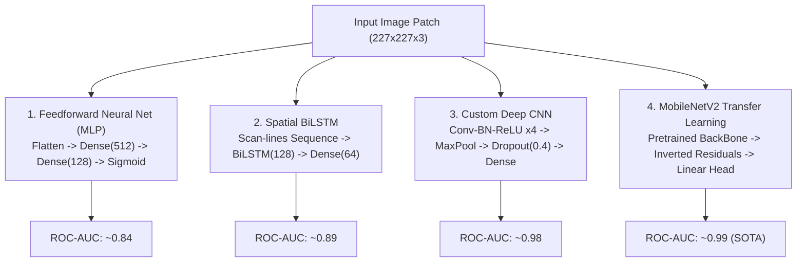

# 🧱 Structural Health Monitoring: Cracked vs Non-Cracked Surface Classification

[](https://www.python.org/)
[](https://pytorch.org/)
[](LICENSE)

An end-to-end Computer Vision deep learning pipeline for automated surface crack identification in civil infrastructures (bridges, roadways, concrete walls). Developed by **Ammar Abdelfattah & Project Team** at the **Faculty of Engineering – New Ismailia National University (NINU)**.

---

## 📌 Executive Summary & Architecture Benchmark

Surface crack detection is framed as a binary patch classification task:
- **Class 0**: Intact, non-cracked concrete surface.
- **Class 1**: Compromised, cracked surface.

To thoroughly evaluate neural representation learning, four architectures were developed and benchmarked:



---

## 🔬 Experimental Findings & Hyperparameter Tuning

- **Transfer Learning Supremacy**: Pretrained MobileNetV2 converged within 5 epochs achieving >99.1% test accuracy and near-zero false negatives.
- **Overfitting Prevention**: Dropout rate $p=0.4$ combined with AdamW optimizer ($\text{weight\_decay}=10^{-4}$) and Cosine Annealing learning rate schedule stabilized validation loss.
- **Dataset**: Kaggle Cracked vs Non-cracked Concrete Surface Dataset.

---

## 📁 Repository Structure

```text
├── NN_Cracked_Classification.ipynb   # Reproducible PyTorch & Sklearn notebook
├── Documentation.md                  # Comprehensive mathematical & architectural report
├── Customer_Churn_Neural_Network.pdf # Initial project report
├── requirements.txt                  # Python dependencies
└── README.md                         # Project documentation
```

---

## 🚀 Setup & Execution

```bash
# Clone repository
git clone https://github.com/marbdalftah72-spec/Neural-Network.git
cd Neural-Network

# Install requirements
pip install -r requirements.txt

# Run training & evaluation notebook
jupyter notebook NN_Cracked_Classification.ipynb
```

---

## 👨‍💻 Authors & Academic Attribution

- **Ammar Abdelfattah & Project Team**
- Faculty of Engineering, **New Ismailia National University (NINU)**
